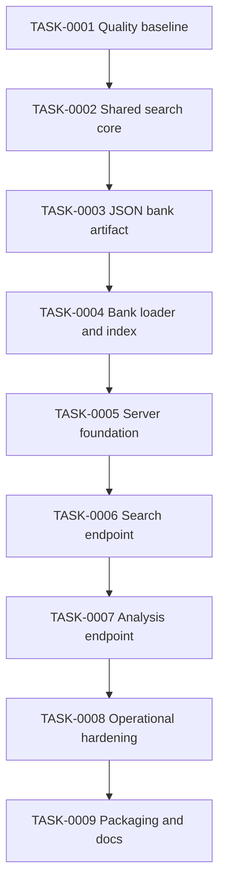

# Task Board

This folder follows the Kanban workflow defined in [`../AGENTS.md`](../AGENTS.md).
Task files live in one of four state folders (`backlog`, `in-progress`, `review`,
`complete`). This page is an index for the current epic, not a task file.

## Epic: REST API for Serangkai Guesser

**Outcome:** expose the existing three-syllable word matcher as a JSON HTTP API
from this repository, without changing CLI behavior and without adding a
database.

**Why this repository:** the valuable logic is the pure, tested tokenizer,
wildcard matcher, and syllable heuristic in `helpers/`, plus the word-bank build
pipeline in `main.js`. A new repository would duplicate that logic and drift on
digraph/diphthong semantics. The HTTP layer is a thin adapter over the same
`data/` artifacts.

**Non-goals for this epic**

- Authentication, accounts, or user game sessions.
- Exposing dictionary sync/rebuild over unauthenticated HTTP.
- A frontend UI.
- A separate repository or service.
- A database. The bank is small enough to keep in memory.

### Task sequence

| ID | Title | Depends on | Size (est.) | State |
|----|-------|------------|-------------|-------|
| TASK-0001 | Quality baseline: lint, format, CI | — | S (~150 lines) | in-progress |
| TASK-0002 | Extract shared search core, remove reusable `process.exit` | 0001 | M (~200 lines) | backlog |
| TASK-0003 | Emit `data/word-bank.json` | 0002 | M (~200 lines) | backlog |
| TASK-0004 | Word bank loader and in-memory index | 0002, 0003 | M (~250 lines) | backlog |
| TASK-0005 | Express server foundation | 0004 | M (~200 lines) | backlog |
| TASK-0006 | `GET /api/words` search endpoint | 0005 | M (~250 lines) | backlog |
| TASK-0007 | `GET /api/words/:word` analysis endpoint | 0006 | S (~150 lines) | backlog |
| TASK-0008 | Operational hardening: CORS, rate limit, logging | 0006, 0007 | M (~200 lines) | backlog |
| TASK-0009 | Packaging, scripts, Docker, and docs | 0006, 0007, 0008 | M (~200 lines) | backlog |

Each task is sized to stay below the ~400 changed-line guideline in
`AGENTS.md`, excluding generated data. Tasks are sequential by contract; do not
start a task until its dependencies are merged.

### Global decisions

1. **Stay in this repository.** Add `lib/` and `server/` alongside the CLI.
2. **Keep CommonJS.** The repository is `"type": "commonjs"`; the API will not
   migrate to ESM as part of this epic.
3. **Express 5 on Node 20+.** Express 5 gives async error propagation and is the
   current stable line. Raise `engines` to `>=20` in TASK-0009.
4. **In-memory, read-only word bank.** Load `data/word-bank.json` once at boot,
   pre-tokenize, freeze. No database and no request-time disk reads.
5. **No public sync endpoint.** Dictionary sync remains a build/CLI step because
   it performs a slow outbound fetch.
6. **Version the artifact and the API.** `data/word-bank.json` carries
   `schemaVersion: 1`; HTTP routes live under `/api`.
7. **Data is not committed.** `data/` stays gitignored. Deployment must generate
   the artifact in CI or mount a volume (see TASK-0009).

### Open decisions to resolve before TASK-0001

- **Base branch:** `AGENTS.md` says branch from `master`, but this repository is
  currently on `main` with `origin/main`. Confirm whether `master` should be
  created or whether the workflow text should be updated to `main`. Until then,
  use the repository default branch as the base and record the choice in each
  task's Status Log.
- **CI provider:** tasks assume GitHub Actions. If another provider is used,
  only TASK-0001's workflow file changes.
- **Owners:** every task file currently has `Owner: TBD`. Assign an owner before
  moving a task to `in-progress`.
- **Branch prefixes:** `AGENTS.md` names `feat/` and `fix/` only. This plan uses
  `chore/` for tooling/docs and `refactor/` for the behavior-preserving core
  extraction, matching the Conventional Commit types listed in the same file. If
  strict two-prefix enforcement is preferred, rename those branches to `feat/`.

### Epic Definition of Done

- All nine tasks are in `tasks/complete`.
- `npm run lint`, `npm run format:check`, and `npm test` pass in CI.
- `GET /health`, `GET /api/meta`, `GET /api/words`, and
  `GET /api/words/:word` are documented and covered by HTTP tests.
- The container image starts with a prepared bank and passes its health check.
- The README documents the REST API, environment variables, and data
  prerequisites.
